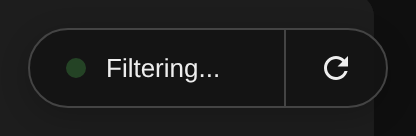
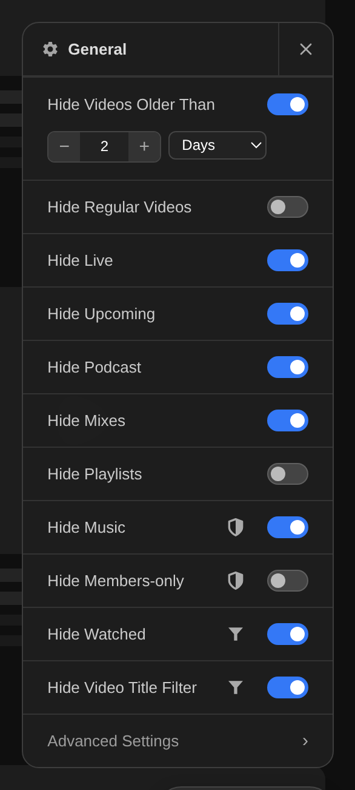
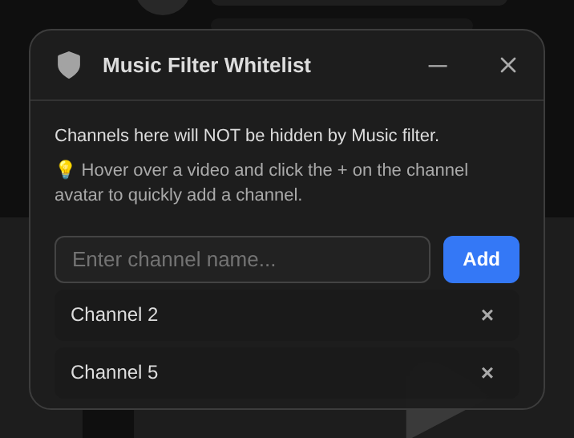
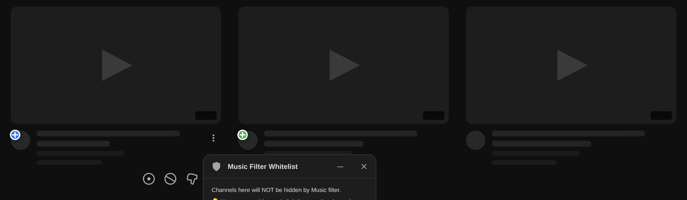
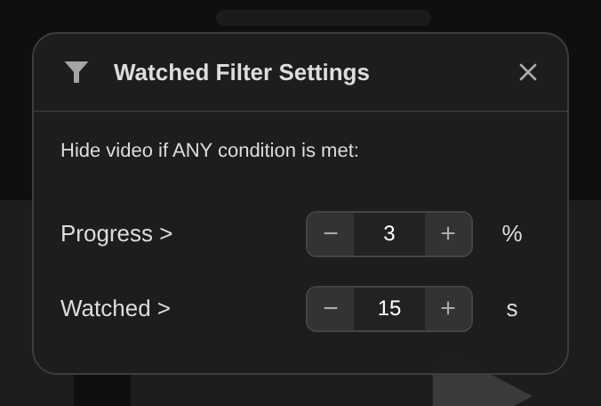
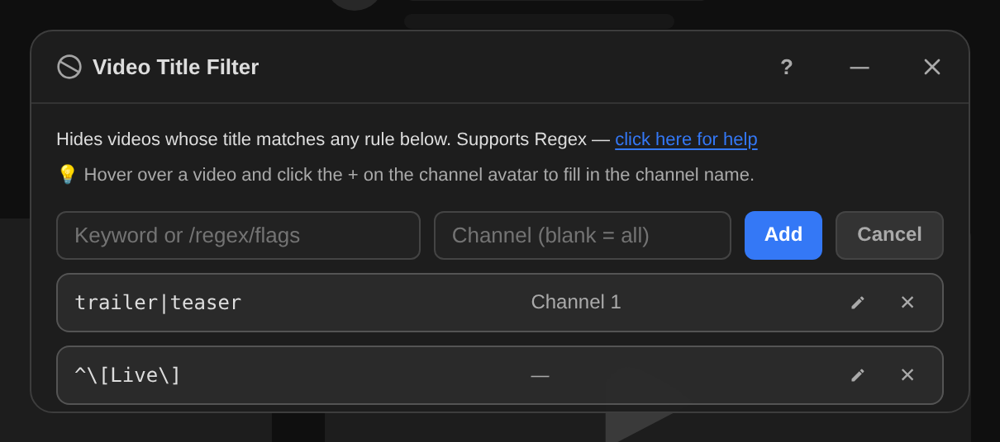
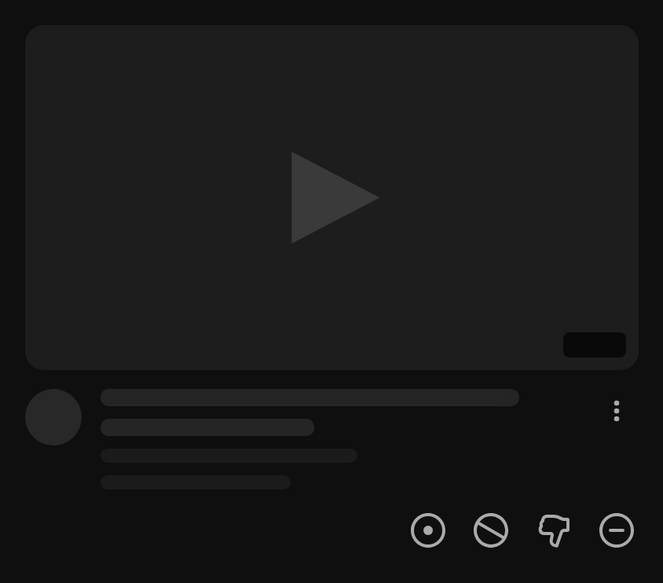
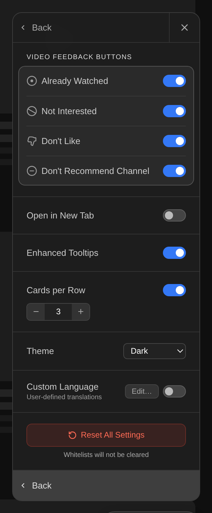
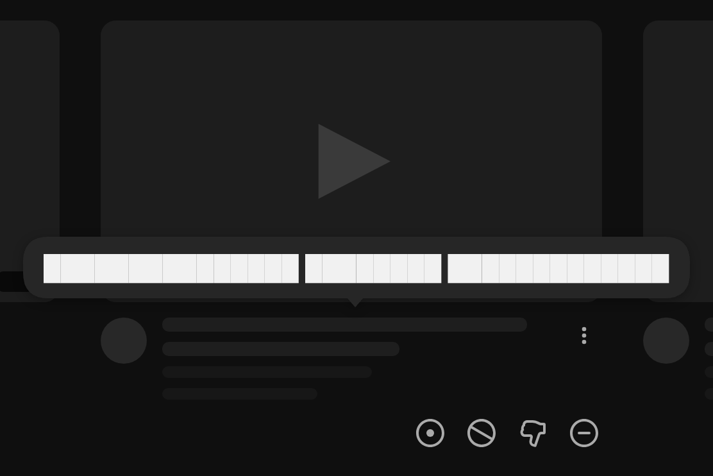

# YouTube Home Filter: Industrial Standard

**English** | [繁體中文](README.zh.md)

A Tampermonkey userscript that filters the YouTube home feed and the watch-page sidebar. Hide videos by age, type, or watch progress; keep the channels you care about with whitelists; and act on recommendations without opening the three-dot menu.

> In every screenshot below, YouTube's own content is replaced by a skeleton mock-up — grey bars instead of titles, blank thumbnails with a play arrow. Only the script's own UI is real.

## Install

1. Install [Tampermonkey](https://www.tampermonkey.net/) (Firefox or Chrome).
2. [**Install the script**](https://raw.githubusercontent.com/bgtsai/youtube-home-filter/main/youtube-home-filter.user.js)
3. Reload the YouTube home page.

Auto-update is enabled, so Tampermonkey will prompt you when a new version is pushed.

## The control pill

Everything starts from a pill at the bottom-right corner of the page. It shows whether filtering is on, and the circular arrow reloads the feed. Clicking the status area reveals a gear that opens the settings.

## Settings panel

One panel holds every filter. Each row is an independent switch, so you can combine them freely — hide live streams but keep playlists, or hide everything except live streams.

### Filter by age

The first row hides anything older than a threshold you set, in any unit from seconds to years.

There is no absolute timestamp in a card's data — YouTube only ships a localized relative string such as "3 hours ago". The script therefore builds the matching phrase templates at runtime from `Intl.RelativeTimeFormat`, using the page's own `<html lang>`. Because `Intl` and YouTube draw on the same CLDR data, the parsing works in every YouTube interface language, and it is independent of which language this panel is displaying. It was verified against 1130 real time strings collected across 50 locales, with every one parsed correctly.

### Filter by video type

| Type | How it is detected |
|---|---|
| Regular videos | Everything *except* the special types below — useful for a feed of only live streams or playlists |
| Live streams | `badgeStyle` is `LIVE`. Only streams that are **on air right now** match; a finished stream's archive carries a duration badge instead, so archives are never hidden by this switch |
| Scheduled / premieres | The "Notify me" button on the card |
| Music | The music badge icon |
| Members-only | The members badge icon |
| Podcasts | `contentType` is `PODCAST` |
| Mixes | `contentType` is `PLAYLIST` and the list id starts with `RD` |
| Playlists | `contentType` is `PLAYLIST` without that prefix |

All of these read structured enum values out of the card's own view-model rather than matching text, so no type filter depends on your interface language.

Sponsored cards carry no view-model at all, and are always hidden. There is no switch for this.

### Channel whitelists

Two separate whitelists override the music and members-only filters, so you can hide a whole category while keeping a few channels in it. The shield icons in the settings panel open them.

You can type a channel name into the panel, but the quick way is on the feed itself. While a whitelist panel is open, every channel avatar grows a button: **blue +** to add that channel, **green +** for a channel already on the list. Click to toggle.

### Filter by watch progress

Hides videos you have already started, based on the progress bar YouTube draws on the thumbnail. Two independent thresholds; either one marks a video as watched.

The second threshold exists because 3% of a three-hour video is over five minutes.

### Title keyword filter

Hides videos whose title matches a rule. A rule is a plain keyword or a `/regex/flags` pattern, and can be limited to one channel or applied to every channel.

While this panel is open the channel avatars become fillable here too: hover a video, click the + on its avatar, and the channel name drops into the field.

## Quick feedback buttons

Hovering a card shows a row of buttons aligned with YouTube's three-dot menu. Each one sends YouTube's own feedback action directly — including the follow-up reason, in a single click, where the native menu would ask a second question.

From left to right: **Already watched**, **Not interested**, **Don't like**, **Don't recommend this channel**. Every action shows an undo card, and a video you remove stays removed for the rest of the page session even if the feed re-renders. Which buttons appear is configurable.

## Advanced settings

- **Video feedback buttons** — pick which of the four appear on hover
- **Open in new tab**
- **Enhanced tooltips** — see below
- **Cards per row** — override YouTube's grid, 3 to 10
- **Theme** — light, dark, or follow the system
- **Custom language** — edit or add UI translations

The feed also fetches more videos by itself when filtering leaves it too sparse, and the pill reports it while it happens.

### Enhanced tooltips

YouTube truncates long titles and its native tooltip is slow and easy to miss. With this on, hovering a title shows the full text immediately.

## Where the filters apply

The home feed, and the "All" tab of the watch page's right-hand sidebar. Both use the same rules and the same code path — the script works on the inner `yt-lockup-view-model`, which is what the two layouts have in common.

## Compatibility

Developed and tested on **Firefox + Tampermonkey**. **Chrome** is supported: the script installs a Trusted Types policy so its UI renders under YouTube's Chrome-only Trusted Types enforcement.

All DOM selectors live in a single `YT_SELECTORS` object near the top of the file. When YouTube changes its markup, that object is usually the only thing that needs updating.

## Credits

Written by BGTsai with Gemini and Claude.

## License

[MIT](LICENSE)
