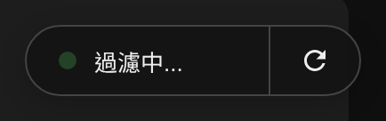
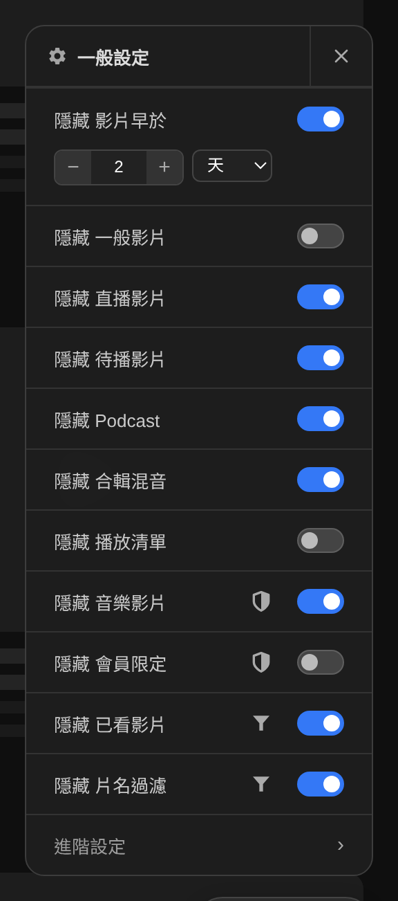
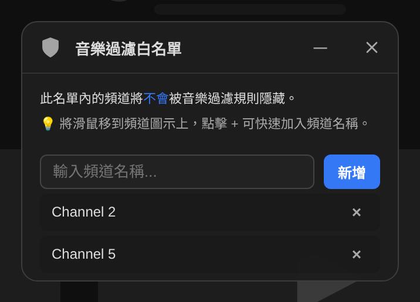
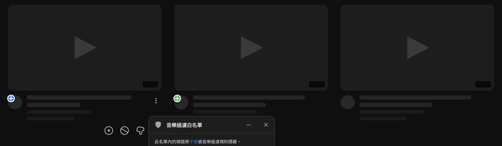
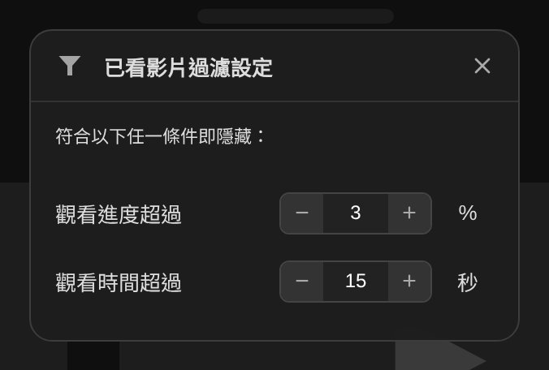
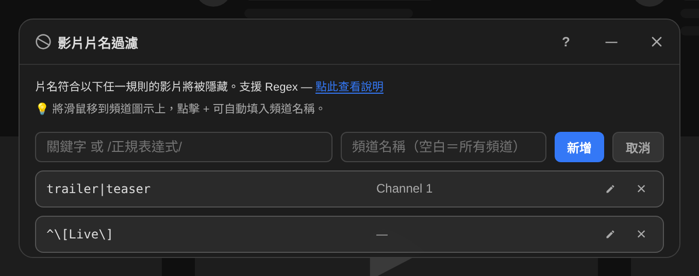
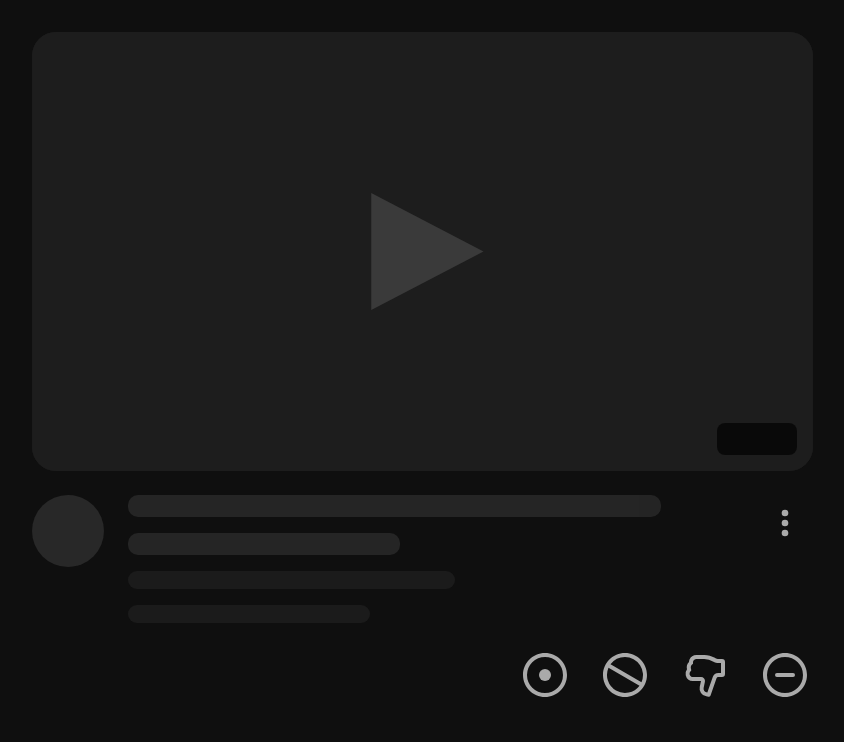
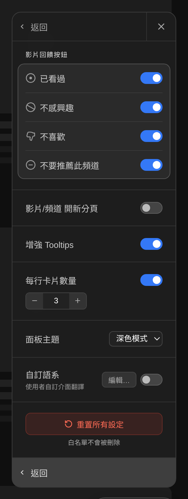
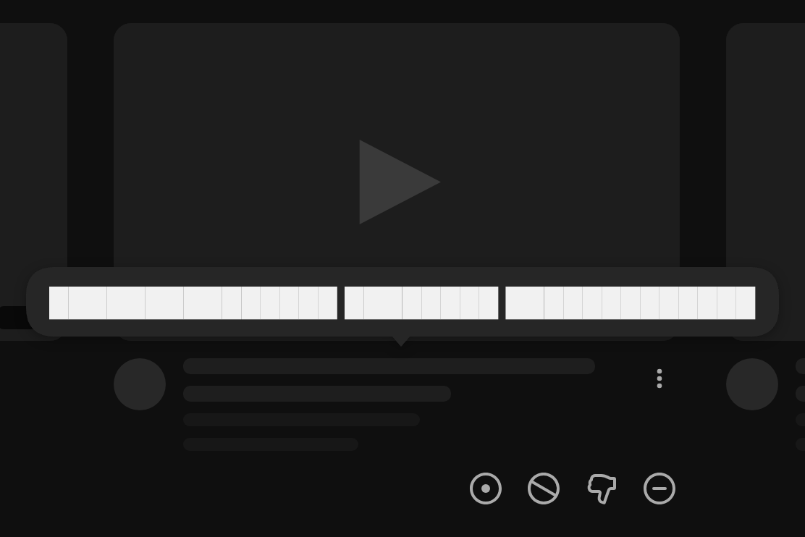

# YouTube Home Filter: Industrial Standard

[English](README.md) | **繁體中文**

過濾 YouTube 首頁與播放頁側欄影片的 Tampermonkey 使用者腳本。可依年齡、類型、觀看進度隱藏影片，用白名單保留在意的頻道，並且不必打開三點選單就能對推薦內容做出回饋。

> 以下截圖裡，YouTube 自己的內容一律換成骨架示意圖——標題用灰色色條、縮圖是帶播放箭頭的空白方塊。畫面上只有腳本本身的介面是真的。

## 安裝

1. 安裝 [Tampermonkey](https://www.tampermonkey.net/)（Firefox 或 Chrome）。
2. [**安裝腳本**](https://raw.githubusercontent.com/bgtsai/youtube-home-filter/main/youtube-home-filter.user.js)
3. 重新整理 YouTube 首頁。

已啟用自動更新，推送新版本後 Tampermonkey 會主動提示。

## 控制膠囊

一切從畫面右下角的膠囊開始。它顯示目前是否正在過濾，右邊的圓形箭頭可以重新整理首頁；把滑鼠移到狀態區，會出現開啟設定面板的齒輪。

## 設定面板

所有過濾集中在同一個面板，每一列都是獨立開關，可以任意組合——例如擋掉直播但保留播放清單，或是反過來只留直播。

### 依年齡過濾

第一列用來隱藏超過指定時間的影片，單位從秒到年都可以。

卡片資料裡其實沒有絕對時間戳，YouTube 只給當地語言的相對字串（例如「3 小時前」）。因此腳本改用頁面自己的 `<html lang>`，在執行時以 `Intl.RelativeTimeFormat` 即時產生對應的語句樣板再回推秒數。由於 `Intl` 與 YouTube 共用同一套 CLDR 資料，這個解析在任何 YouTube 介面語言下都成立，而且與這個面板目前顯示哪種語言完全無關。此機制已用 50 個語系、1130 筆實際時間字串驗證，全數解析正確。

### 依類型過濾

| 類型 | 判斷依據 |
|---|---|
| 一般影片 | 下列特殊類型「以外」的全部影片——想要一個只剩直播或播放清單的首頁時很好用 |
| 直播影片 | `badgeStyle` 為 `LIVE`，也就是**此刻正在播出**。已結束的直播存檔帶的是時長徽章，因此不會被這個開關誤殺 |
| 預約／首播 | 卡片上的「通知我」按鈕 |
| 音樂 | 音樂徽章圖示 |
| 會員專屬 | 會員徽章圖示 |
| Podcast | `contentType` 為 `PODCAST` |
| 合輯混音 | `contentType` 為 `PLAYLIST` 且清單 id 以 `RD` 開頭 |
| 播放清單 | `contentType` 為 `PLAYLIST` 且沒有該前綴 |

這些判斷全部直接讀卡片本身的結構化列舉值，不比對文字，所以類型過濾完全不受介面語言影響。

贊助商廣告卡片沒有這份資料結構，一律直接隱藏，不另外提供開關。

### 頻道白名單

兩份獨立白名單，優先權高於音樂與會員過濾，可以在隱藏整個類別的同時保留少數頻道。設定面板上的盾牌圖示就是入口。

頻道名稱可以直接打進面板，但更快的方式是在首頁上操作。白名單面板開啟期間，每個頻道頭像都會長出一顆按鈕：**藍色 +** 代表可以加入，**綠色 +** 代表這個頻道已經在名單上，點一下即可切換。

### 依觀看進度過濾

依 YouTube 畫在縮圖上的進度條，隱藏已經看過的影片。兩個獨立門檻，任一達成即視為已看過。

第二個門檻之所以存在，是因為三小時的影片 3% 就超過五分鐘了。

### 片名過濾

隱藏標題命中規則的影片。規則可以是單純的關鍵字，也可以是 `/regex/flags` 形式的正規表達式；可以限定只對某個頻道生效，也可以套用到所有頻道。

這個面板開啟時，頻道頭像同樣會出現 +，點一下就能把頻道名稱直接填進欄位。

## 快速回饋按鈕

滑鼠移到卡片上，會出現一排與 YouTube 三點選單對齊的按鈕。每一顆都直接送出 YouTube 自己的回饋動作——原生選單還要再問一次理由的，這裡一鍵連理由一起送出。

由左至右依序是：**我已經看過這部影片**、**不感興趣**、**我不喜歡這部影片**、**不要推薦此頻道**。每個動作都會顯示可復原的通知卡；移除過的影片在該次頁面工作階段內不會再出現，即使首頁重新渲染也一樣。要顯示哪幾顆按鈕可以自行設定。

## 進階設定

- **影片回饋按鈕**——選擇四顆按鈕中要顯示哪些
- **在新分頁開啟連結**
- **增強 tooltip**——見下方
- **每列卡片數**——覆寫 YouTube 的格線，3 到 10
- **主題**——淺色、深色或跟隨系統
- **自訂語言**——編輯或新增介面翻譯

過濾後若剩下的影片太少，腳本也會自行捲動補抓，期間膠囊會顯示目前狀態。

### 增強 tooltip

YouTube 會截斷過長的標題，而原生 tooltip 既慢又容易錯過。開啟這個選項後，滑鼠移到標題上就會立刻顯示完整內容。

## 過濾在哪些頁面生效

首頁，以及播放頁右側影片清單的「全部」分頁。兩者套用同一套規則、走同一條程式路徑——腳本處理的是內層的 `yt-lockup-view-model`，那正是兩種版面共通的部分。

## 相容性

在 **Firefox + Tampermonkey** 上開發與測試。**Chrome** 同樣支援：腳本會建立 Trusted Types policy，讓介面能在 YouTube 於 Chrome 強制啟用 Trusted Types 的情況下正常渲染。

所有 DOM 選擇器集中在檔案前段的 `YT_SELECTORS` 物件裡。YouTube 改版時，通常只需要修改這一個物件。

## 致謝

由 BGTsai 與 Gemini、Claude 共同撰寫。

## 授權

[MIT](LICENSE)
